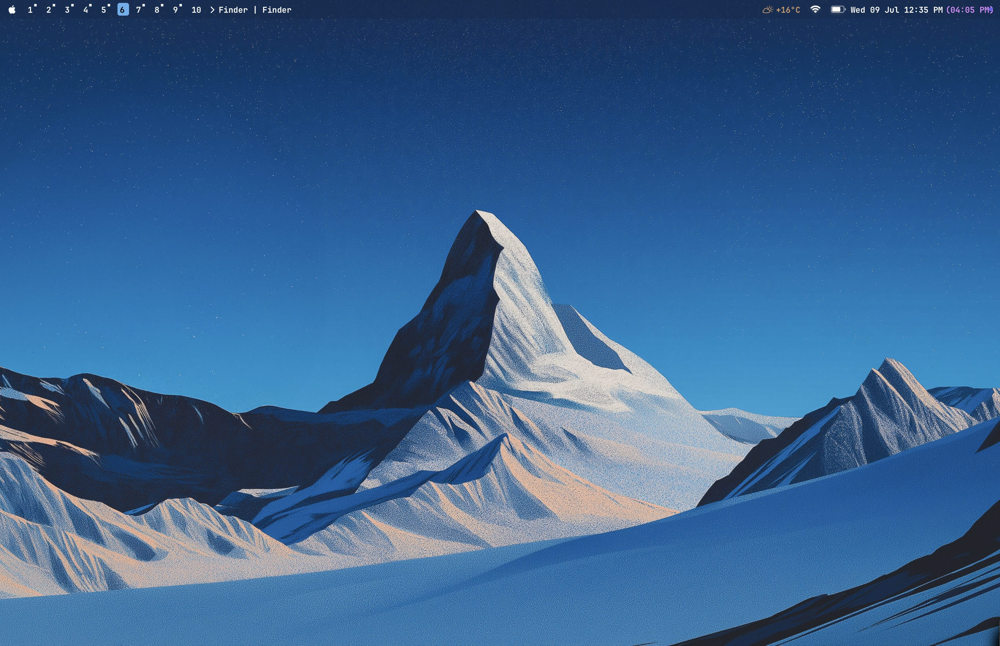

# macOS dotfiles



### Using

- [AeroSpace](https://github.com/nikitabobko/AeroSpace) — tiling window manager
- [SketchyBar](https://github.com/FelixKratz/SketchyBar) — top bar
- [Ghostty](https://ghostty.org) — terminal, with [tmux](https://github.com/tmux/tmux)
- zsh — no framework; plugins are cloned on first start
- [Atuin](https://atuin.sh) — shell history
- [Colima](https://github.com/abiosoft/colima) — Docker runtime
- [catppuccin theme](https://github.com/catppuccin/catppuccin)

## Install

```sh
xcode-select --install
sudo softwareupdate --install-rosetta --agree-to-license
git clone https://github.com/pankajadhyapak/dotfiles-mac.git ~/.dotfiles
~/.dotfiles/install.sh
```

`install.sh` installs Homebrew if it's missing, runs `brew bundle`, links every config below,
sets the wallpaper and applies the macOS defaults in `.macos`. It is safe to re-run.

Dev dependencies (PHP tools, Terraform, Go via gobrew): `./dev.sh`

## Layout

| Repo | Linked to |
|---|---|
| `zsh/zshrc`, `zsh-aliases`, `zsh-functions`, `zsh-prompt` | `~/.config/zsh/` (`zshrc` → `.zshrc`) |
| `zsh/.zshenv` | `~/.zshenv` |
| `ghostty/` | `~/.config/ghostty` |
| `tmux/` | `~/.config/tmux` |
| `aerospace/` | `~/.config/aerospace` |
| `sketchybar/` | `~/.config/sketchybar` |
| `karabiner/` | `~/.config/karabiner` |
| `atuin/config.toml` | `~/.config/atuin/config.toml` |
| `colima/colima.yaml` | `~/.config/colima/default/colima.yaml` |
| `git/gitignore` | `~/.gitignore` |
| `git/gitconfig` | copied to `~/.gitconfig` only if it doesn't exist |
| `vscode.json` | VS Code `settings.json` |

## Machine-specific settings and secrets

Anything that belongs to one machine — work aliases, project variables, API keys — goes in
`~/.config/zsh/local.zsh`. It's sourced last by `zshrc`, created with `chmod 600`, and never committed.

Export secrets there and nowhere else. Tools that need one, including MCP servers, should
reference the variable (`"$JIRA_API_TOKEN"`, `"${GEMINI_API_KEY}"`) rather than hold a copy of the value.

Two files are deliberately not tracked: `local.zsh` and `sketchybar/plugins/data.sh`
(the `data` bar item stays blank without it).

## Keys

| Keys | Action |
|---|---|
| `cmd-1` … `cmd-0` | AeroSpace: go to workspace 1–10 |
| `hyper-1` … `hyper-0` | AeroSpace: move window to workspace and follow |
| `alt-h/j/k/l` | AeroSpace: focus; with `shift` move, with `ctrl` join |
| `alt-r` | AeroSpace: resize mode (`h/j/k/l`, `esc` to leave) |
| `ctrl-b` | tmux prefix; Ghostty's `cmd` shortcuts send prefix combos (see `ghostty/config`) |
| `ctrl-e` | zsh: edit the command line in `$EDITOR` |

## Docker

```sh
# Delete any configuration from previous installs
rm -rf ~/.docker/config.json

colima start
colima status
```

`DOCKER_HOST` points at Colima's socket (set in `zshrc`).

## Maintenance

```sh
brew bundle dump --describe -f   # refresh the Brewfile from what's installed
update                           # alias: brew update, upgrade, cleanup
```

## Slack theme

```
#1E1E2E,#CBA6F7,#00FF2A,#EBA0AC
```
